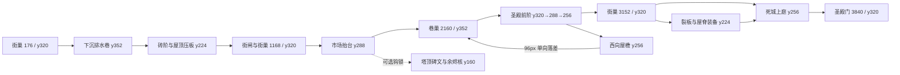

# 第三章：锈城街巷重排蓝图

本章身份是空城的街面与屋顶互为路线。主路只用单跳、冲刺和已经获得的热锻；钩锁只通往旧塔的世界信息与余烬核。`ChapterText` 的故事、出口字幕、章节顺序和存档 v2 不改。

## 空间与节奏

| 区域 | 坐标 / 台面 | 路线、遭遇与喘息 |
| --- | --- | --- |
| 地窟门外 | x0–512 / y320 | 保留入口、窗碑与街巢 x176。x400 的松瓦先落碎屑、画落点边线，0.9 秒后落下；两侧各至少 64px 可停步。先单独读机关。 |
| 下沉排水巷 | x512–928 / y352→320→288→256 | 街面下降一层，砖阶从沟里引上屋檐。碎铁犬在低处，喷吐者在入口石阶，构成第一处双高度遭遇。犬后移至 x640，警戒 128px，喷吐者警戒 224px；首个落瓦及两侧等待区不唤醒这组敌人。可以走低街，也能上屋檐。 |
| 屋顶与街闸 | x928–1536 / 屋顶 y224、街面 y320 | 屋檐以固定瓦面夹两块塌瓦；首块塌瓦下有实心街道，失误只掉回低路。街巢东侧 x1328/1392 的两级砖阶升至 y288/256，再向西单跳冲刺回 y224 压板，读档或失足后均有返程。闸门上方固定砖楣封住新台阶的越门路径；开门后的地面净空仍为64px。保留 GatePlate/GateDoor 节点。 |
| 市集抬台 | x1536–2112 / y288→320 | 第二处遭遇：普通犬与疾行犬分守台面、飞魔从空中切入；落瓦落点在高台东侧，屋顶不是纯安全通道。塔顶 y160 保持钩锁支路，保留 SteleTower/EmberCoreTower。 |
| 雾中窄巷 | x2112–2432 / y352 | 巷巢 x2160 在西端安全平面，装甲犬与幽魂在东端伏击，第三处遭遇由低檐压缩视线并与落瓦组合。敌人出生/巡逻边界均在巢的警戒圈之外。 |
| 圣殿前阶 | x2432–2848 / y320→288→256 | 喷吐者与盾卫守不同台阶；原 SteleStair 留在前台。前台可向西经 y256 的屋檐回巢：x2448/y224→2352/y256→塌瓦2288→2192，末端落回巷巢，96px 高差使其不能从巷底反爬。主线仍走下层台阶。 |
| 死城回环 | x2848–3552 / 街320→288→256，屋顶224→192 | 街巢 x3152。可选挑战从砖阶上死屋檐，经裂板与塌瓦拿 RewardDeadQuarter 装备，再沿东屋脊下落回街面。街/屋顶由分开的台面提供两个战斗角度。 |
| 圣殿门外 | x3552–4000 / y320 | 从上庭落回门前街面，喷吐者守街尾。出口 x3840 到 level04，保留 Props/Exit、level03_done 与章节入点。 |

## 本章两类专属机关

1. **塌瓦屋檐**：复用 `CollapsingPlatform`，0.7 秒抖动、3.0 秒复位。固定瓦面至少 64px；教学处下方是街面，主线永远不依赖已塌瓦面。压板、巢、碑文、拾取和敌人都站在固定台面上。
2. **屋檐落物**：本章独有 `CyclicHazard` 子类，复用确定性相位、预警/休止/safe_window、HintArea 与 Hitbox。显示锈红碎瓦，落点线与碎屑预警 0.9 秒，落下时判定跟随瓦片，落地后碎成不伤人的残片。首遇说明“先看落尘，等瓦落定再过”，不显示钟的提示。四处落点错相，机关离巢、门、压板、碑文、核至少 40px。故事文本没有新增或改写。

## 回巢与兼容边界

- 巢脚点：176/320、1168/320、2160/352、3152/320；相邻水平距离均 992px，最后到出口 688px。
- 旧的 Street/Plaza/Alley 巢名和父级、GatePlate/GateDoor、三块 Stele、EmberCoreTower、RewardDeadQuarter、Exit 均保留；新增 Quarter 巢。地形可重排，存档键不改。
- 回巢捷径是实体屋檐上的西行路线和末端单向下落，普通单跳无法从巷底逆爬 96px；不新增传送，不要求钩锁。
- 本章没有 Boss，不新增 Boss 或改变章节顺序。圣殿门前的三段高低台承担本章战斗高潮。

## 验收计划

- 章节 layout 测试：基础能力到达全部巢、压板和出口；压板实机接线；两条屋顶环线与奖励；钩锁支路保持可选；屋檐末端单向性；巢距与敌人六秒静置；落瓦预警、安全窗、冻结与画面/判定同步。
- 门禁：`level_sanity`、`route_audit`、`chapter_progression`、`level_routing`、`level_weather`，并申请统一时段执行全量 `tools/run_tests.ps1`。
- 渲染：镜头中心 x400/1120/1744/2480/3320，y220；1280×720 与 1920×1080 各五张，逐张检查净空、落脚、敌人地形关系、机关可读性、遮挡与空场。
- 截图是构图验收；正常输入整章通关、真人手感和实体手柄不由静态截图或几何测试推断。实际证据完成后在此追加记录。

## 已完成验收（2026-10-24）

实现保留街面、下沉排水巷、市场抬台、圣殿前阶和死城上庭；五块塌瓦与四处松瓦落物均已接入工具箱的机关组、提示和审计。主线压板、四个巢、出口及固定屋脊奖励可达。塔顶碑文和余烬核仍需可选钩锁。本章没有 Boss，未增加 Boss 或更改故事、14 章路由、持久化旧名与存档格式。

| 过滤用例 | 实际结果 |
| --- | --- |
| `level03` | 13/13，含屋顶压板实机触发、96px 单向回巢边、奖励支撑、敌人落点、首遇两侧固定落脚；四个巢及首个落瓦两侧等待区各以真实 AI 静置六秒检查无伤害、无读招；松瓦覆盖预警、跟随碰撞、落地残片收刀、碎片期出生与过场冻结。 |
| `level_sanity`，`RUSTGRAVE_LEVEL_FILTER=level03` | 13/13，第三章几何与机关无问题。 |
| `route_audit` / `chapter_progression` / `level_routing` | 2/2、3/3、6/6；第三章四巢最大间距 992px，基础能力可从各巢到出口。 |
| `level_weather` / `chapter_art_audit` / `prop_fit` | 6/6、4/4、7/7。 |
| `chapter_support` / `parallax_backdrop` | 2/2、8/8。 |
| `destructible_placement` | 3/3，裂板破坏后仍有固定奖励台面，主路独立于裂板。 |

过滤命令为 `tools/run_tests.ps1 -CaseFilter <上表名称> -TimeoutSeconds 240 -ArtifactsDir <绝对证据路径>`。各轮日志、stderr 与 summary.json 在 `screenshots/acceptance/overhaul-v3/level03-resume/tests-*`；章节测试目录是 `tests-chapter`，体检目录是 `tests-sanity-initial`。

首次完整测试文件集执行 `tools/run_tests.ps1 -TimeoutSeconds 900`，保留第三章 `RUSTGRAVE_LEVEL_FILTER`：1298/1299，0 个引擎错误；唯一失败是旧 `destructible_placement` 仍要求裂板恰好 64×64。已把该测试改为固定屋檐支撑、可破坏开路和破坏后的奖励落脚检查。最终修正后的章节 13/13、体检 13/13、路线审计 2/2、破坏物回归 3/3，分别存于 `final-level03`、`final-level_sanity`、`final-route_audit`、`final-destructible_placement`。两个更新服务 HTTP 用例曾提示缺少 Node 服务并跳过；整合分支仍须完成无章节过滤的最终全量门禁，不能把这次失败轮次记成全绿。

最终机位图位于 `screenshots/acceptance/overhaul-v3/level03-resume/1280x720/` 和 `1920x1080/`，每目录五张 `live_<x>_level03_lit_active.png`。已逐张查看 x400、1120、1744、2480、3320：入口落脚和下沉路、压板屋檐与街闸、市场与钩锁塔、巷底与回巢屋檐、死城高庭与屋顶奖励均可辨；未发现悬空装饰、埋地敌人或挡住落脚区的大装饰。

截图使用真实 `GamePresentation`、运行中的机关和敌人 AI，镜头固定 y220。通用 `PeekLive` 把骑士固定在 y320，会在新高低台产生假埋地/假悬空；因此仅在上述忽略目录保留 `CaptureLevel03.tscn`、`capture_level03.gd` 和 `run_capture.ps1` 作为本地构图夹具，按 `LAYOUT.FLOORS` 把骑士脚点放到对应主路台面。共享工具未改。画面中的战斗与提示来自固定机位，不能当作正常输入通关证据。

本次未验证正常输入整章通关、真人手感或实体手柄；没有改共享脚本或其他章节。

## 普通输入恢复回归（2026-10-24）

后续 Alley 巢到 Quarter 巢的真实输入检查发现两处主路净空：回廊台盖住 StairB 的32px落脚；DeadStepA 的东缘与奖励裂板下方屋檐形成低顶死角。回廊台改为 x2448/y224、宽48，保留西行回巢；DeadStepA缩至32px，留出下落回街面的空间。导航读取未破坏裂板的真实分块碰撞，避免把支路当成主路。`alley-street-final` 中两条实体输入恢复用例2/2、19断言通过（无敌人/机关夹具，不替代有敌人整章战役）。最终全量和新渲染结果另记整合验收。

整章输入驱动在真实 Plaza 巢存档（x1172/y320，GateDoor尚未打开）发现：西侧上屋檐的原阶梯无法从街面反爬，原静态可达检查不足以证明恢复路线。新增东侧两级砖阶和闸门砖楣，保持原压板位置、单跳/冲刺能力和保存路径。

`level03_recovery` 的最终输入回归 1/1、10断言通过，证据在 `screenshots/acceptance/overhaul-v3/level03-recovery/tests-input-final`：真实玩家从巢脚点出发，依次上 y288/y256 台阶，向西跨64px间隙登屋顶，实际触发 PressurePlate→ArenaDoor 信号。未授予钩锁或额外跳跃；封闭闸门的导航图不能绕过砖楣到达市场。敌人与机关在该几何夹具中移除，因此它证明恢复路线物理可行，不代替完整有敌人战役。

首轮章节14/14、全章体检13/13、路线审计2/2通过；这些首轮在最终砖楣补入之前运行。进度恢复用例触发30秒测试看门狗，保留失败日志，等待分章执行和整合全量复验，不计为通过。五机位 x400/1120/1380/2480/3320 的720p/1080p新图位于本回归目录，十张实际尺寸均核对为1280×720或1920×1080，并逐张检查了两张联系表和1380原图，实体返程阶梯、门上砖楣、压板落脚均可辨。整合复验结果后续追加。

## 主路净空修正后的补充构图与西行返巢（2026-10-24）

本轮只复验 `49bcdb7` / `e7c021f` 的既有修正，不再次修改关卡或共享导航：`AlleyReturnStep` 位于 x2448/y224、宽48，`DeadStepA` 位于 x2928/y288、宽32。对受影响的镜头 x2480、2960（CamY220）重新生成720p/1080p四张，并逐张检查原图。

证据位于 `screenshots/acceptance/overhaul-v3/level03-route-fix/`（本地忽略目录）：`1280x720/`、`1920x1080/` 各含 `live_2480_level03_lit_active.png` 与 `live_2960_level03_lit_active.png`；`manifest.json` 记录四张PNG的真实尺寸、SHA256及三份日志校验值，尺寸分别严格为1280×720与1920×1080。x2480的短高檐已让出主路StairA/B跳跃上方空间，阶面与前台清楚；x2960的32px短砖阶与可选奖励屋顶之间有下街缺口，骑士落在真实街面。两个分辨率均未见大装饰遮挡落脚、埋地敌人或假悬空骑士；真实AI、机关和GamePresentation均运行，四张截图骑士脚点分别为2360/352、2856/320。两份`capture.log`无引擎错误。

西行路线另以真实Player、生产输入跨越逻辑和实际碰撞完成：从Terrace的2680/256出发，依次跃至移位后的AlleyReturnStep，降至EaveE，穿过真实CollapseAlley，再到EaveD，最后从96px落差下街抵达真实Alley巢。五条边全部成功，11断言通过、0失败；末端脚点2166.486/351.9253，对应巢脚点2166/354。`west-return.log`含每条边的落脚、着地状态和最终断言；无额外跳跃或钩锁，初始出生后未写玩家位置、速度或碰撞。敌人仅为隔离几何而移除，落瓦等机关及塌瓦实体保留；该检查不替代有敌人整章战役、真人手感或实体手柄验证。

`WestReturn.tscn`、`west_return.gd`、复制的生产输入脚本和补齐旧分支缺失依赖的本地夹具均留在同一忽略目录，不进入提交；共享工具与游戏代码未改。此补充只提交本文档，最终全量和完整普通输入战役由整合分支统一验收。
