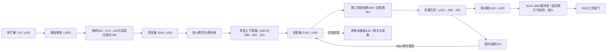

# 圣殿地窖：暗室与烛光桥蓝图

主线用单跳、冲刺和既有热锻穿过三间有下层回收路的暗室；烛光桥负责通向固定压板台。钩锁只通向原有账本末页与装备奖励，不改 ChapterText、14 章次序、出口旗标、唱诗班本体或存档格式。

| 区段 | 地形与机制 | 遭遇与回收 |
| --- | --- | --- |
| x0–416 | 前厅 y320，原入口和街巢；烛台 x384。 | 第一块烛桥前是固定落脚。 |
| x416–1024 | 下层 y352；烛桥 x448/y304 后接固定教学台 x544/y304，续燃烛台 x600 点亮后续 y272、240 台阶，最后到固定 ChoirLoft/y208 与原名压板。 | 第一组：下层骸骨、东口短射程喷吐者、暗室幽魂；教学等待台不在这组的唤醒范围。桥熄灭落回 y352，可向西单跳返回烛台。 |
| x1024–1472 | 骨室巢 x1168；x1328 烛火循环先单独读招；原名街闸 x1456配固定门楣224。 | 烛火前后均有至少48px固定安全落脚，远离巢、碑、门与敌人。门顶与门楣间隙16px，无法单跳绕过；踩板后下方80px净空可通行。 |
| x1472–2080 | 下层 y352；固定上台288、烛桥256、固定骨台224；东侧石阶320→288→256。 | 第二组：爆裂骸骨守低巷，幽魂遮上路，盾卫守东阶；下层能向两端退出，爆裂有退路。 |
| x2080–2752 | 地窖巢 x2160；原账本楼座 y136 为钩锁支路。第三暗室下层352，两块临时烛桥288构成快路。 | 第三组：低巷骸骨与东阶喷吐者；可选楼座幽魂守原装备奖励。烛桥失败落到下层固定地面，东西两端都有回程阶。 |
| x2752–3216 | 主路320→288→256→320；高廊从东端回到巢上方 y224，末端落回地窖巢，96px不能逆爬。唱诗巢3152距离Boss门64px。 | 原 SteleYir 与两字路牌放在固定主路。四巢相邻992px。 |
| x3216–3824 | 唱诗堂连续回收地面320；左右固定侧龛288，两块短时烛桥256，左右烛火喷口3384/3656，中央指挥位置3520保持平地。 | Boss的尺寸、受击盒、攻击表和相数不变。章节入口触发器到入场后才启动Boss物理/介绍，避免Boss在巢前追出并唤醒；场地火焰有安全侧龛，临时台熄灭落回平地。 |
| x3824–4000 | 出口3920，原level04b_done、choir_dead条件、level05入点。 | 战后离场。 |

两种机制复用已落地工具箱：CandleBridge（6秒、末段1.2秒闪烁）与CyclicHazard烛火（0.9秒预警、静止地面安全等候）。所有巢、压板、门、碑、奖励均有固定支撑。主线必须做一次烛桥上台踩板；下层回收路保证熄灭不会致死或软锁。

持久化旧名保留：EmberNestAnte/Bone/Choir、ReliquaryGatePlate/Door、SteleChoir/Yir/Ledger、HookLedger、Pickups/RewardLedger、SilentChoir、Exit；新增EmberNestVault和章节局部入场触发器。共享运行时不改；旧art-audit中04b的纯平竞技场断言改成连续回收地面、可达侧台及机关避让检查，02b断言保持。

2026-10-24实测（Godot4.7.1，独立APPDATA）：`tools/run_tests.ps1 -CaseFilter <下列名称> -ArtifactsDir <绝对路径>`：level04b_layout **16/16**、silent_choir **9/9**、candle_bridge **3/3**、route_audit **2/2**、chapter_progression **3/3**、level_routing **6/6**、level_weather **6/6**、chapter_art_audit **4/4**、prop_fit **7/7**、chapter_support **2/2**、parallax_backdrop **8/8**全部通过，均为0引擎错误。`RUSTGRAVE_LEVEL_FILTER=level04b`下的level_sanity **13/13**通过；route_audit报告本关四巢、最大间距992px。

真实Player与AI测试包括：九块桥点燃后可站、熄灭后落到实际固定地面并可循固定路回到烛台；四巢各等候6秒不受伤、不唤醒攻击；第一处烛桥的两座固定烛台与第一处烛火两侧等候区各等候6秒安全；闭门单跳不能绕过、踩固定压板后实际向右走过门；Boss巢前不启动、入场接管原AI、死亡后原choir_dead旗标解锁竞技场和出口。装备支路仍只能借钩锁进入。

证据根目录：`screenshots/acceptance/overhaul-v3/level04b/`（gitignore，本地保留）。最终测试日志是`tests-layout-final`、`tests-level_sanity`及其余`tests-<名称>-final`；五机位600/1152/1728/2496/3520各拍1280×720与1920×1080，另拍两种尺寸的介绍结束后Boss全景，**共12张逐张检查**。固定落脚与下层石路清楚，烛桥剪影和烛台暖池分出暗室节奏，场地608px及两侧龛完整可见。`render-review.json`记录每张尺寸、SHA256和检查结论。渲染临时使用主分支工具修复abfd624中的PeekLive接地逻辑，两个工具文件未纳入本章提交。

本分支未重复跑全量：与主agent协调后，由其在04b/05与系统修复合入后运行最终集成全量，**此门待主分支确认**。截图与几何检查不等同于正常输入整章通关、真人手感或实体手柄验证。Godot导入产生的素材`.import`及音频资源重写保持未暂存。

2026-10-24 集成输入复验：原 ReturnLaunch 覆盖 VaultStairA→VaultStairB 的起跳头部空间，移为 `(2688,256)`、宽64，保留西向回巢高廊。`level04b_recovery` 使用真实 Player 和生产导航输入，从地窖巢走下回收层、连续单跳石阶、落回唱诗巢；移除敌人与危险以隔离地形，未解锁二段跳或钩锁，**1/1、9断言、0引擎错误**。更新后的完整章节用例 **16/16、0引擎错误**。证据：`level04b/vault-input-verified/`、`level04b/layout-after-clearance/`。完整战役另已通过本章实际敌人与唱诗班门禁并进入工坊；这与上述地形隔离测试分别记录。移动后的高廊补充渲染与西返验证已在下节归档。

## 高廊移位后的构图与真实西返补验（2026-10-24）

按 `f1d7c43` 同步的既有几何复验：`ReturnLaunch` 位于2688/256、宽64，高廊其余固定台不变。新增可复用用例 `test_vault_stair_returns_west_via_the_real_launch_and_high_gallery`，从真实VaultStairB的2848/288出发，以普通单跳/冲刺依次经过ReturnLaunch、ReturnD、ReturnC、ReturnB、ReturnEnd，再沿96px单向落差回到FloorVault，步行抵达真实地窖巢。六条跨越边均实际着地，西返11断言通过，最终脚点2166.607/319.9253（巢目标2166/322），HP5；不授予二段跳或钩锁，出生安置后不写玩家位置、速度或碰撞。

同轮复跑既有向东恢复用例，合计 **2/2、20断言（9+11）、0失败、0引擎错误**。两例均移除敌人与危险以隔离固定几何，故只证明真实输入物理可行。旧分支缺少共享测试驱动依赖，执行时在忽略目录复制整合分支生产导航、危险等待策略与测试夹具；已逐字核对，实际执行的两例与提交的测试仅驱动资源路径不同，提交仍使用标准`tests/fixtures/navigation_driver.gd`。未编辑共享导航或章节几何。

补图为CamY220、x2496高廊局部与x2848回收阶，两档各两张，已逐张查看全部四张原图。高廊固定跨距、移位后的接入台、回收层与三段主路阶面均可辨；接入台没有继续盖住VaultStairA→B的上跳空间，骑士分别接地2376/320与2728/352，未见停放骑士埋地或悬空。真实AI、烛桥、机关与GamePresentation保持运行，截图骑士为停放无敌夹具，不作为普通输入战役证据。

证据在本地忽略目录 `screenshots/acceptance/overhaul-v3/level04b-route-fix/`：`1280x720/`、`1920x1080/`各含`live_2496_level04b_lit_active.png`、`live_2848_level04b_lit_active.png`，PNG真实尺寸严格为1280×720或1920×1080。`manifest.json`记录尺寸、SHA256、逐图检查结论、夹具校验与物理结果；两份`capture.log`各保存两张，`recovery-input.log`记录两条恢复用例及西返每条边，三份日志均无引擎错误。捕获场景、驱动副本与运行脚本均仅留在该忽略目录，未改共享工具。此补验未追加全量、完整有敌人战役、真人手感或实体手柄结论。
