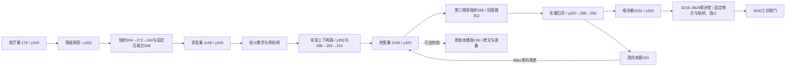

# 圣殿地窖：暗室与烛光桥蓝图

主线用单跳、冲刺和既有热锻穿过三间有下层回收路的暗室；烛光桥负责通向固定压板台。钩锁只通向原有账本末页与装备奖励，不改 ChapterText、14 章次序、出口旗标、唱诗班本体或存档格式。

| 区段 | 地形与机制 | 遭遇与回收 |
| --- | --- | --- |
| x0–416 | 前厅 y320，原入口和街巢；烛台 x384。 | 第一块烛桥前是固定落脚。 |
| x416–1024 | 下层 y352；烛桥 x448/y304 后接固定教学台 x544/y304，续燃烛台 x600 点亮后续 y272、240 台阶，最后到固定 ChoirLoft/y208 与原名压板。 | 第一组：下层骸骨、东口短射程喷吐者、暗室幽魂；教学等待台不在这组的唤醒范围。桥熄灭落回 y352，可向西单跳返回烛台。 |
| x1024–1472 | 骨室巢 x1168；x1328 烛火循环先单独读招；原名街闸 x1456。 | 烛火前后均有至少48px固定安全落脚，远离巢、碑、门与敌人。 |
| x1472–2080 | 下层 y352；固定上台288、烛桥256、固定骨台224；东侧石阶320→288→256。 | 第二组：爆裂骸骨守低巷，幽魂遮上路，盾卫守东阶；下层能向两端退出，爆裂有退路。 |
| x2080–2752 | 地窖巢 x2160；原账本楼座 y136 为钩锁支路。第三暗室下层352，两块临时烛桥288构成快路。 | 第三组：低巷骸骨与东阶喷吐者；可选楼座幽魂守原装备奖励。烛桥失败落到下层固定地面，东西两端都有回程阶。 |
| x2752–3216 | 主路320→288→256→320；高廊从东端回到巢上方 y224，末端落回地窖巢，96px不能逆爬。唱诗巢3152距离Boss门64px。 | 原 SteleYir 与两字路牌放在固定主路。四巢相邻992px。 |
| x3216–3824 | 唱诗堂连续回收地面320；左右固定侧龛288，两块短时烛桥256，左右烛火喷口3384/3656，中央指挥位置3520保持平地。 | Boss的尺寸、受击盒、攻击表和相数不变。章节入口触发器到入场后才启动Boss物理/介绍，避免Boss在巢前追出并唤醒；场地火焰有安全侧龛，临时台熄灭落回平地。 |
| x3824–4000 | 出口3920，原level04b_done、choir_dead条件、level05入点。 | 战后离场。 |

两种机制复用已落地工具箱：CandleBridge（6秒、末段1.2秒闪烁）与CyclicHazard烛火（0.9秒预警、静止地面安全等候）。所有巢、压板、门、碑、奖励均有固定支撑。主线必须做一次烛桥上台踩板；下层回收路保证熄灭不会致死或软锁。

持久化旧名保留：EmberNestAnte/Bone/Choir、ReliquaryGatePlate/Door、SteleChoir/Yir/Ledger、HookLedger、Pickups/RewardLedger、SilentChoir、Exit；新增EmberNestVault和章节局部入场触发器。共享运行时不改；旧art-audit中04b的纯平竞技场断言改成连续回收地面、可达侧台及机关避让检查，02b断言保持。

验收：level04b_layout、silent_choir、candle_bridge、按章LevelSanity；route_audit、chapter_progression、level_routing、level_weather、chapter_art_audit、prop_fit、chapter_support、parallax_backdrop。真实AI检查四巢与两种首遇；实际玩家跌落与回收；压板接线；竞技场入场/清场；五机位×1280×720与1920×1080逐张看图，另拍Boss全景。全量时段与主agent协调，最终记录实际结果。截图与几何检查不等同于正常输入整章通关、真人手感或实体手柄验证。
