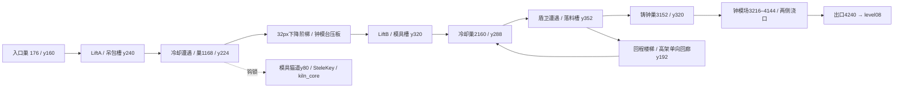

# 锈墓・拾：铸钟厅（level07b）蓝图

铸钟厅改为向城底下沉的阶梯铸造线：入口浇铸台 y160 → 吊包冷却台 y224 → 钟模坑 y288 → 铸钟场 y320。两台吊台分别跨越两个落料槽，槽底是可回收的固定干地。熔渣从上方浇口向下喷落，与各自吊台共用八秒时钟；吊台经过浇口时必须处于休止期，过场结束也要恢复同步。

| x 范围 | 地形与机制 | 遭遇、巢与回收 |
| --- | --- | --- |
| 0–768 | 入口台 y160；LiftA 从480/176沿176/32轨道往返；632/80向下熔注。槽底 y240，失足后向东回到 y224。 | 巢176/160。第一机关两端保留固定读招区，教学不叠加敌人攻击。 |
| 768–1472 | 冷却台 y224；1408起两级32px下降，接钟模底层 y288。 | 第一遭遇：短巡逻碎铁犬与喷吐者；巢1168/224。高处可选幽魂守猫道奖励。 |
| 1472–2080 | MoldStep y256、MoldDeck y224，原压板开1808/224闸门；固定门楣阻止从门顶绕过。LiftB1888/272沿96/0轨道过模具槽；2032/176向下熔注。 | 第二遭遇集中在压板台与门前。下层320固定干地可一跳回到 y288。 |
| 2080–3008 | 冷却台 y288；高架回廊 y192通过32px楼梯从东侧登上，西端落回2160巢，不能原地反跳上回廊。2752–3008落料槽 y352。 | 巢2160/288。第三遭遇为 heavy_guard、armored_scrapper、低空飞魔；落槽后向东32px台阶脱困。 |
| 3008–3216 | 铸造台从320台阶接入 Boss 前厅。 | 保留原 EmberNestCast，3152/320，距 Boss 入口64px；四巢依次相隔992px。 |
| 3216–4144 | 钟模场有连续 y320恢复地面；中央 y288钟模台以两侧缓坡连接，避免不会跳跃的 Boss 被垂直台壁卡住；两侧固定高台与上方浇口。 | Boss 从3696/288起步。原 cast_pillar_west / east 阶段事件分别点燃两侧熔注；不改 Boss 数值、碰撞、攻击或相数，清场收刀。 |
| 4144–4320 | 4240出口，右侧留80px。 | 保留 founder_dead 解锁、level07b_done 与 level08 自动入点。 |

熔注参数：主线两口均为休止6.2s、预警0.8s、活动1.0s；LiftA初相0，LiftB初相0.5。章内专用 CyclicHazard 子类直接跟随对应吊台时钟，导演锁住输入时保持无伤，解锁后重新同步。验收采样整个甲板和26px高骑士包络，不能只测吊台中心。Boss 浇口独立使用阶段触发，不在开战前自行循环。

可选支路保留 HookMold1152/-16、MoldCatwalk1080/80宽192、SteleKey1128/80与 CoreReward1216/32（kiln_core）。主线 allow_hook=false 不到此处，钩锁可达。其余持久化名称沿用 EmberNestEntry / Ladle / Cast、MoldGatePlate / Door、SteleMold / Founder、BellFounder、Exit；新增巢为 EmberNestCooling。故事、章节顺序与 ChapterText 原文不变。

## 验收计划

- 更新 level07b_layout：无钩锁主线、两槽失足回收、压板实际开门、门顶绕过阻断、四巢与首遇读招区六秒实机AI安全、奖励支路、单向回廊、Boss缓坡行走和阶段浇口/死亡清场。
- 熔注/吊台完整周期包络安全及导演锁前后时钟一致；bell_founder、cyclic_hazard、moving_platform相关回归。
- level_sanity只过滤07b；route_audit、chapter_progression、level_routing、level_weather、chapter_art_audit、prop_fit、chapter_support、parallax_backdrop。
- 五机位600/1152/1728/2496/3696，各1280×720和1920×1080，额外Boss全景，逐张检查并记录尺寸与SHA256。
- 独立分支不跑全量；主分支合并后由主agent统一跑权威全量。截图与自动化几何/物理验收不等同于正常输入整章通关或真人手感结论。

当前状态：设计蓝图，实施与验收待完成。
