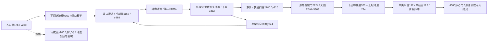

# 锈墓・拾肆：炉心深处（level10）蓝图

终章从两条踏石渣渠改为下探回廊与环形大殿。入口台y288下探到y352的送渣槽，循喷口休止窗口穿过；中段回到y288读碑与存档，再下到y352低空火骷髅廊，东侧爬回y320到梦魇门前。大殿由下层冲锋环道、上层外圈走道、中央炉台与四座立柱台组成，保留梦魇原始缩放、判定、攻击ID及三阶段边界收缩。

| x范围 | 几何与机制 | 遭遇、巢与捷径 |
| --- | --- | --- |
| 0–416 | 入口台y288，原SteleNightmare与炉心路牌；HookVigil把守夜台移至y160，原SteleVigil文字不变，增加奖励。 | 原EmberNestGate176/288，支路幽魂只在高处唤醒，不能干扰巢。 |
| 416–992 | 槽底y352；两个向上渣喷口528/656，预警≥0.8s、错相，前后固定读招区。928起32px回收阶梯。 | 第一场渡口：幽魂+单头低空火骷髅，教学落脚区保持六秒安全。 |
| 992–1472 | 冷却台y288，第二组喷口与碑廊；向东32px下降。 | 新EmberNestCooling1168/288；第二场围绕高低台的幽魂/火骷髅，距巢在唤醒圈外。 |
| 1472–1968 | 下层y352的低空双头廊，东侧32px阶梯返回y320；上层单向回廊y224经东阶可达，西端落到冷却巢，不能反跳。 | 第三场为联动警戒的两只火骷髅与一只幽魂；不新增heavy_guard或改共享敌人变体表。 |
| 1968–2240 | 门前厅y320；原SteleCompact、原ArenaGate2224/256。 | 原EmberNestArena2160/320，三巢依次相隔992px，Boss入口2240距巢80px。 |
| 2240–3968 | 下层y320连续冲锋道；两侧32px阶梯接上层y224外环，分段走道互相一跳可达；四座64px宽立柱台y192；中央炉台y192。上层底面不低于y240，下层至少80px净空。 | Nightmare在3504/320起步。三处贴地shock脉冲中心2768/3056/3344、宽288、高16，可基本跳跃或爬上环道规避。两侧阶梯不占中央冲锋直线；上层给绕行路线。 |
| 3968–4160 | 原ForgeAltar与4080炉心门，东墙留80px。 | 原nightmare_dead门锁、give/keep字幕、confirm_ending、game_complete/ending保存与回标题流程全部保留。 |

炉心脉冲使用本章专属CyclicHazard子类：开战前不启动；arena_started启一阶段中央慢脉冲（rest4.5/warn0.9/active0.8）；仅匹配梦魇名号的boss_phase_changed启二阶段三口（3.0/0.9/0.8），三阶段加速至（2.0/0.8/0.8），用启动延迟错相、每次重排都完整预警，不能直接跳进判定期。Director锁住时无伤且冻结；arena_cleared立即三口收刀，已死重载不创建脉冲或Boss。共享Boss/机关基类、故事与结局脚本不改。

主线只需单跳、冲刺、热锻；守夜台仍钩锁专属。持续化名称保留EmberNestGate/Arena、ArenaGate、SteleNightmare/Compact/Vigil、HookVigil、Exit与Nightmare。三处主线遭遇使用原幽魂/火骷髅，通过低空、警戒与范围形成变奏，不新增重盾敌人。

验收：level10_layout更新支撑/主路/回收/三巢六秒AI/首喷口安全/环道/奖励/单向回廊/真实脉冲跳跃与高台规避/阶段事件重排与收刀/死亡重载/两结局持久化；nightmare_boss、filtered level_sanity、route_audit、chapter_progression、routing/weather/art/prop/support/parallax。五点600/1168/1744/2752/3504各1280×720与1920×1080，另拍Boss全景，逐图记录尺寸/SHA。独立分支不跑full，交主分支权威全量；正常输入整章通关、真人/实体手柄手感不由截图或几何测试代替。

当前状态：设计蓝图，实施与验收待完成。
